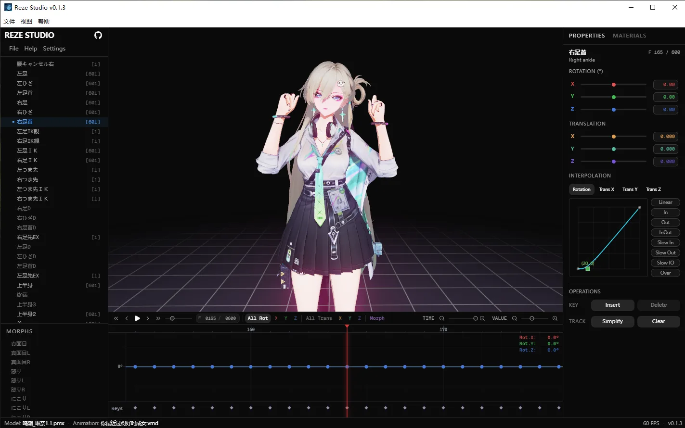

# Reze Studio 桌面客户端

**Reze Studio Desktop** is a cross-platform desktop app for hand-keying and editing MMD (MikuMikuDance) `.vmd` animation clips — timeline, dopesheet and per-channel Bézier curve editing — built on top of [reze-studio](https://github.com/AmyangXYZ/reze-studio). It renders locally in real time via WebGPU and serves the UI from an embedded Next.js server — no external services required. Works on Windows & macOS.

Reze Studio Desktop 是一款跨平台的开源 [MMD（MikuMikuDance）](https://sites.google.com/view/vpvp/) 角色动作编辑软件，基于 [reze-studio](https://github.com/AmyangXYZ/reze-studio) 封装，使用 WebGPU 实时渲染。提供时间轴、dopesheet（关键帧表）与逐通道曲线编辑器，支持手 K `.vmd` 动作、编辑修复MMD动作、导入/导出 VMD、从本地文件夹加载 PMX 模型，离线在本地运行。

## 截图



## 功能

- 离线本地运行:Electron 内嵌 `next start`,无需外部服务
- PMX 模型与 VMD 动画加载渲染(IK 与物理)
- 时间轴 + dopesheet + 逐通道 Bézier 曲线编辑器
- 关键帧插入/删除,旋转/位移滑块,骨骼/变形列表
- VMD 导入/导出
- WebGPU 自动检测与说明指引(双显卡/驱动问题排查)
- 发行剥离:内置版权模型/动画不出现在发行包内,打开为空编辑器,自行从文件菜单导入 PMX/VMD
- 在线访问作者站点、检查更新入口(配置于 `config.json`)
- Windows NSIS 向导式安装 / macOS 未签名 dmg(随附放行说明)

## 环境要求

- Node.js 22(`.nvmrc` 已锁定)
- 显卡支持 WebGPU(Windows: D3D12;macOS: Metal),详见 `resources/WebGPU-guide.md`

## 开发

```bash
# 拉取时含子模块
git clone --recurse-submodules <repo-url>
cd reze-studio-desktop

npm install
npm run dev        # 启动 Electron + reze-studio 开发服务器
```

## 打包

```bash
npm run dist        # 完整构建(空场景版:构建期置 NEXT_PUBLIC_USE_DEFAULT_ASSETS=false)
npm run dist -- --skip-build   # 复用已有 .next(空场景不生效,不建议用于发行)
```

- Windows 产物:`dist/RezeStudio-<version>-Setup.exe`(NSIS 向导式)
- macOS 产物:`dist/RezeStudio-<version>.dmg`(未签名,安装见 `resources/MAC-install.md`)

图标由 `build/icon-source.jpg` 生成:

```bash
npm run make-icon   # 产出 build/icon.ico、icon.png、icon.icns
```

## 目录结构

```
electron/            Electron 主进程与 preload
scripts/             dev / dist / make-icon / after-pack
resources/           说明文档
config.json          在线地址、更新地址、端口
reze-studio/         子模块(上游 reze-studio)
```

## License

[GPL-3.0](LICENSE)

## 致谢
感谢 [AmyangXYZ](https://github.com/AmyangXYZ/) 创建并维护了优秀的 reze-engine MMD WebGPU 引擎，以及其他相关项目。
